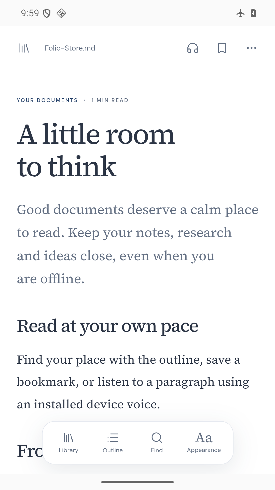

# Folio

A little room to read. Folio is a mobile Markdown reader with Mermaid diagrams, highlighted code, mathematics, and a personal offline library.

**[Open the free web app](https://timsamart.github.io/folio/)** · **[Download for Android](https://github.com/timsamart/folio/releases/latest)** · **[Privacy](https://timsamart.github.io/folio/privacy.html)**

## Read your way

- Read Markdown files, essays, research notes, and technical documents offline.
- View Mermaid diagrams, highlighted code, LaTeX mathematics, tables and footnotes.
- Find a phrase, use the outline, bookmark a document, and return to your reading place.
- Choose your reading font, spacing, width, focus mode, and light or dark appearance.
- Listen to a paragraph or a section using an installed offline device voice.
- Export original Markdown and back up or restore your library.

## Free web app

[Open Folio](https://timsamart.github.io/folio/) in your browser. The web app is free, with no account or payment required. Use the browser's Install app command, or Safari's Add to Home Screen on iPhone/iPad. Keep the app open until offline reading is ready.

Your library belongs to that browser and installation. Browser storage can be cleared or evicted; keep an independent library backup.

## Android

Download the **Android APK** from [Releases](https://github.com/timsamart/folio/releases/latest), then choose **Files > your .md file > Open with > Folio**. You can also share files into the app. [Installation and updates](docs/ANDROID-RELEASE.md)

The direct APK download remains free. A **USD $2.99 one-time Google Play edition is planned**, with local prices set through Play. It has not yet been published there. There is no subscription or in-app purchase.

Install newer APKs over the existing app to retain your library. Direct downloads do not update automatically. The APK and browser app have separate libraries; export a backup from one and restore it in the other.

## Listening and privacy

Only installed voices reported as usable offline are offered. Quality and available languages depend on your device's speech engine and downloaded voice data. Playback pauses when you leave Folio; resume restarts the interrupted sentence. Premium voices, screen-off listening and cloud synchronization are not included.

Folio has no account, ads or analytics. Documents stay in local storage. Remote Markdown images load only when requested. Read [the privacy explanation](https://timsamart.github.io/folio/privacy.html).

## Downloads and support

This repository contains the built web app, public releases, and user documentation. Development source and its history are maintained separately. GitHub's automatic source archives contain distribution records/files, not the development source.

Report problems or ideas in [Issues](https://github.com/timsamart/folio/issues). Include your device, Android/browser version and steps, without private document contents. Third-party licenses are included with the [web app](https://timsamart.github.io/folio/licenses/dependencies.txt) and downloadable builds.
